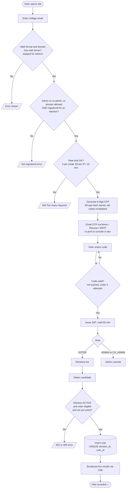
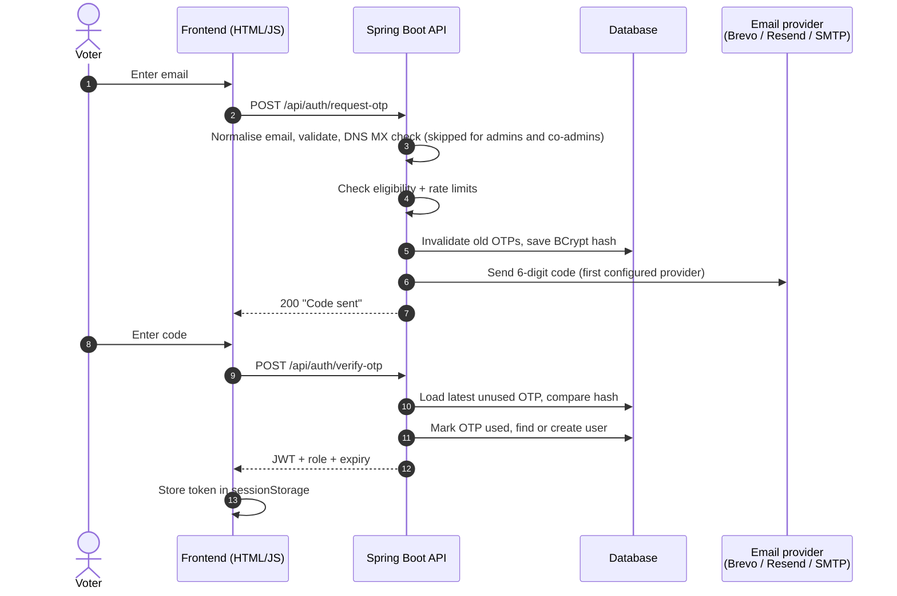
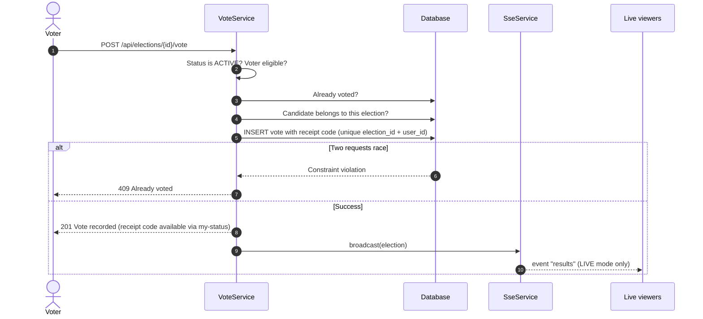
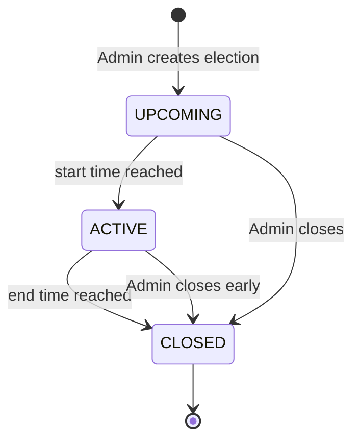
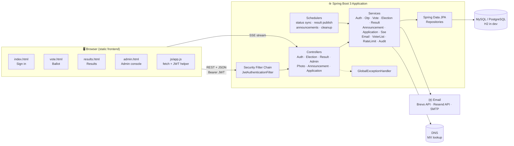
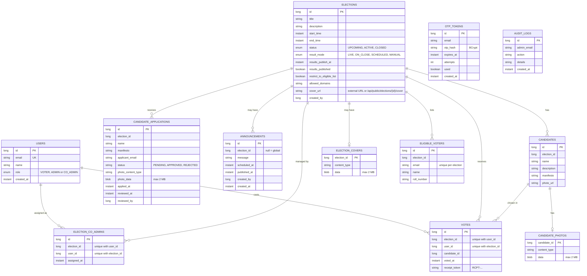

<div align="center">

# 🗳️ Online Voting System

### Secure, passwordless, one-person-one-vote elections for colleges

*Sign in with an email code. Vote once. Watch results on your terms.*

### 🌐 [Live demo: online-voting-system-b4m9.onrender.com](https://online-voting-system-b4m9.onrender.com/)

> The web UI is branded **CampusVote** (logo and campus images live in `static/images/`). Rename it by editing the `<title>` tags, the brand text in the HTML pages and the images.


[](https://online-voting-system-b4m9.onrender.com/)

[Features](#-features) · [How it works](#-how-it-works) · [Architecture](#-architecture) · [Tech stack](#-tech-stack) · [Quick start](#-quick-start) · [Configuration](#-configuration) · [API](#-api-reference) · [Deployment](#-deployment) · [Security](#-security-design)

</div>

---

## 📖 Overview

**Online Voting System** is a full-stack web application for running verifiable, college-scale elections. A **Spring Boot 3** backend exposes a REST API and serves a lightweight **HTML/CSS/JavaScript** frontend from the same process, so the whole system ships as a single deployable unit.

Voters never create or remember a password. They enter their college email, receive a 6-digit one-time code, and are signed in with a short-lived **JWT**. Admins create elections, manage candidates and voter lists, post announcements, review candidacy applications, monitor turnout, and decide exactly **when and how results become visible**. A full admin can also delegate individual elections to **co-admins**.

> **Design goals:** simple to deploy, hard to cheat, easy to audit.

---

## ✨ Features

### 👩‍🎓 For voters
- 🔐 **Passwordless sign-in** with an emailed one-time code (OTP)
- 🗂️ See only the elections you are eligible for
- 🧑‍💼 Browse candidates with photos, descriptions and **manifestos**
- 📝 **Apply to contest** as a candidate (name, manifesto, optional photo) while an election is not closed
- 📢 Read **announcements**, both site-wide and per election, from the dashboard and its bell icon
- 🏆 See the **official winner** (or a tie) highlighted on the results page and election cards once a closed election's results are visible
- ✅ Cast **one vote per election**, guaranteed by a database constraint
- 🔎 Check whether you have voted (and when), never *who* you voted for
- 🧾 Get a **vote receipt code** (`RCPT-…`) as confirmation that your vote was recorded
- 📊 View results according to the election's visibility rule, including **live streaming** results

### 🛠️ For administrators
- 🆕 Create, edit (before voting starts), close and delete elections with a voting window
- 🖼️ Add an election **cover photo**, either by **uploading** an image (JPG, PNG, WebP, GIF, max 2 MB) or by pasting an image **URL**
- 👥 Manage candidates, including **manifesto** and **photo upload** (JPG, PNG, WebP, GIF, max 2 MB)
- ✅ **Approve or reject candidacy applications**; approving creates the candidate (with manifesto and photo) automatically
- 📢 Post **announcements** (global or per election), published instantly or **scheduled**
- 🏆 **Announce the winner** with one click; when results are published the winner announcement is also **posted automatically** (only if at least one vote was cast)
- 🤝 Add **co-admins** from any email domain and assign them specific elections
- 📥 Bulk-import the voter list from **CSV** (auto-normalised, de-duplicated, domain-validated)
- 🌐 Choose eligibility: **voter list only** or **open to a college email domain**
- 🏷️ Set **per-election allowed email domains** (multiple domains supported)
- 📈 Live **turnout dashboard**: eligible, voted, pending, percentage
- 📤 Export **voted / not-voted lists** and **results** as CSV
- 👁️ Control result visibility: `LIVE`, `ON_CLOSE`, `SCHEDULED`, `MANUAL`
- 🧾 Full **audit log** of every admin action (visible to full admins)
- 🧨 **Reset all elections** (full admins only) to wipe test data
- ✉️ Choose how OTP emails are sent: **Brevo API**, **Resend API**, or plain **SMTP**

### 🛡️ Built-in protections
- BCrypt-hashed OTPs with expiry and attempt limits
- Sliding-window **rate limiting** per email and per IP
- Stateless JWT authentication with role-based access (`VOTER`, `CO_ADMIN`, `ADMIN`)
- Per-election access checks for co-admins on every admin endpoint
- DNS **MX/A record check** to reject fake email domains
- Ballot locks after the first vote
- HTTPS email APIs (port 443) for hosts that block SMTP, such as Render
- Non-root Docker container and graceful shutdown

---

## 🔄 How it works



### 🔑 Sign-in sequence



### 🗳️ Vote sequence (race-safe)



### 👁️ Election lifecycle and result visibility



| Mode | Voters see results when… |
|---|---|
| `LIVE` | Always, with real-time updates over Server-Sent Events |
| `ON_CLOSE` | The election has closed (default) |
| `SCHEDULED` | A fixed date and time arrives |
| `MANUAL` | The admin presses **Publish** |

> Admins always see live counts, regardless of mode. Status is **derived from the clock**, so it is correct even if the background scheduler has not run yet.

---

## 🏗️ Architecture



### Layered design

| Layer | Package | Responsibility |
|---|---|---|
| **Presentation** | `controller` | HTTP routes, request validation, status codes |
| **Business logic** | `service` | Eligibility, OTP, voting rules, results, SSE, email, rate limits |
| **Persistence** | `repository`, `entity` | JPA entities and Spring Data repositories |
| **Security** | `security`, `config` | JWT filter, token utility, CORS, route authorization |
| **Cross-cutting** | `exception`, `util`, `scheduler` | Error mapping, CSV/email helpers, background jobs |
| **Transfer objects** | `dto` | Request and response records |

---

## 🧰 Tech stack

| Area | Technology |
|---|---|
| **Language** | Java 17 |
| **Framework** | Spring Boot 3.3.5 (Web, Data JPA, Security, Validation, Mail) |
| **Authentication** | JWT via JJWT 0.12.6, stateless sessions, BCrypt for OTP hashing |
| **Database** | MySQL 8.4 · PostgreSQL · H2 (development) |
| **ORM** | Hibernate / Spring Data JPA (`ddl-auto=update`) |
| **Real-time** | Server-Sent Events (`SseEmitter`) with 25 s heartbeat |
| **Email** | Brevo HTTPS API, Resend HTTPS API, or Spring Mail over SMTP (Gmail or any provider) |
| **API docs** | springdoc-openapi 2.6.0 (Swagger UI) |
| **Frontend** | Vanilla HTML5, CSS3, JavaScript (no build step) |
| **Build** | Maven |
| **Boilerplate** | Lombok 1.18.42 |
| **Testing** | JUnit 5, Spring Boot Test, Spring Security Test |
| **Containers** | Docker multi-stage build, Docker Compose (app + MySQL) |
| **Hosting options** | Render, Google Cloud Run, any VPS |

---

## 🗄️ Data model

Tables are created automatically by Hibernate. Relationships are held as ID columns.

> **Upgrading an existing database?** The `users.role` column gained a third value (`CO_ADMIN`). On startup, `DataInitializer` automatically drops the old role check constraint and widens the column to `VARCHAR(20)` (it tries PostgreSQL, H2 and MySQL syntax). Check the startup log for `Migrated users.role column...` if co-admin sign-in fails on an older database.



---

## 🚀 Quick start

### Prerequisites
- **Java 17+**
- **Maven 3.9+** (or use Docker)

### 1. Run locally (about 2 minutes)

```bash
git clone https://github.com/itz-Arun-001/online_voting_system
cd online_voting_system/online-voting-system      # the folder that contains pom.xml

# Use a real domain for local testing (the app does a DNS mail-server check)
COLLEGE_DOMAIN=gmail.com ADMIN_EMAILS=you@gmail.com mvn spring-boot:run
```

On Windows PowerShell:

```powershell
$env:COLLEGE_DOMAIN = "gmail.com"; $env:ADMIN_EMAILS = "you@gmail.com"; mvn spring-boot:run
```

Open **http://localhost:8080**

- The default `dev` profile uses a file-based **H2** database stored in `./data/`.
- With no email provider configured, the **sign-in code is printed in the console** (look for the `OTP for ... is ######` warning line), so you can test without email.
- Sign in with the address in `ADMIN_EMAILS` to reach the admin console.
- The placeholder domain `yourcollege.edu` can fail the DNS mail-server check, so use a real domain such as `gmail.com` locally.

> Prefer a `.env` file over typing variables each time. A step-by-step walkthrough, including a full test election, is in **[LOCAL_SETUP.md](online-voting-system/LOCAL_SETUP.md)**.

### 2. Send real OTP emails

The app picks the **first provider that is configured**, in this order:

| Priority | Provider | Set these variables | Notes |
|---|---|---|---|
| 1 | **Brevo HTTPS API** | `BREVO_API_KEY`, `MAIL_FROM` | Port 443, works on Render, Railway and other hosts that block SMTP. `MAIL_FROM` must be a sender verified in Brevo. |
| 2 | **Resend HTTPS API** | `RESEND_API_KEY`, `MAIL_FROM` | Port 443. Without a usable `MAIL_FROM`, it falls back to `onboarding@resend.dev` (Resend's test sender). |
| 3 | **SMTP** | `SMTP_HOST`, `SMTP_PORT`, `SMTP_USER`, `SMTP_PASSWORD` | Gmail, Brevo SMTP relay, or any server. |
| none | **Console** | nothing | `dev` profile only: the code is printed in the log. In `prod`, sign-in fails with "Email service is not configured". |

**SMTP with Gmail (simplest for testing):**

1. Create a `.env` file in the folder where you run `mvn` (it is git-ignored).
2. Enable 2-Step Verification, then create an App Password at <https://myaccount.google.com/apppasswords>.
3. Add `SMTP_HOST=smtp.gmail.com`, `SMTP_USER`, `SMTP_PASSWORD`, plus `COLLEGE_DOMAIN` and `ADMIN_EMAILS`. Codes are only sent to addresses on an allowed domain that are an admin or are registered for an election. To test with Gmail, use `COLLEGE_DOMAIN=gmail.com`.
4. Start the app. The console prints one of:
   - `Email is configured via Brevo HTTPS API ...`
   - `Email is configured via Resend HTTPS API ...`
   - `Email is configured: sign-in codes will be emailed through <host> ...`
   - `Email is NOT configured ...` (the `.env` file was not found, or the variables are empty)

> **Careful with `.env.example`:** it contains placeholder SMTP values. If you copy it unchanged, the app tries to send through Gmail with fake credentials and sign-in fails with "Failed to deliver email". Remove or replace the `SMTP_*` lines unless you have real credentials.

### 3. Run with Docker Compose (app + MySQL)

```bash
cp .env.example .env      # then edit the values
docker compose up --build -d
```

Serves on **http://localhost:8080** with a persistent MySQL volume. Compose runs the `prod` profile, so **real email must be configured** (codes are not printed to the console) and `JWT_SECRET` is mandatory. Put it behind HTTPS before sharing the link.

> `docker-compose.yml` currently passes only the `SMTP_*` variables to the app. To use Brevo or Resend with Compose, add `BREVO_API_KEY` / `RESEND_API_KEY` and `MAIL_FROM` to the `app.environment` block.

### 4. Run the tests

```bash
mvn test
```

---

## ⚙️ Configuration

All settings are environment variables (or entries in a `.env` file in the folder you start the app from). Admin accounts are created at startup, so **restart after changing `ADMIN_EMAILS`**.

| Variable | Purpose | Default |
|---|---|---|
| `SPRING_PROFILES_ACTIVE` | `dev` (H2) or `prod` (real database) | `dev` |
| `COLLEGE_DOMAIN` | Comma-separated global domains allowed to sign in (elections can add their own) | `yourcollege.edu` |
| `ADMIN_EMAILS` | Comma-separated **full admin** emails (seeded at startup, no admin signup). Co-admins are added from the admin console instead | `admin@yourcollege.edu` |
| `JWT_SECRET` | 32+ random characters. **Required in production**; app refuses to start without it | dev only |
| `JWT_EXPIRY_MINUTES` | Token lifetime | `60` |
| `DB_URL`, `DB_USERNAME`, `DB_PASSWORD` | `jdbc:mysql://…` or `jdbc:postgresql://…` | none |
| `DB_POOL_SIZE` | Hikari pool size | `5` |
| `DDL_AUTO` | Hibernate schema mode | `update` |
| `BREVO_API_KEY` | Send OTPs through the Brevo HTTPS API (highest priority) | empty |
| `RESEND_API_KEY` | Send OTPs through the Resend HTTPS API | empty |
| `SMTP_HOST`, `SMTP_PORT`, `SMTP_USER`, `SMTP_PASSWORD` | SMTP server for OTPs (used when no API key is set) | none / `587` |
| `MAIL_FROM` | From address. Gmail needs it equal to `SMTP_USER`; Brevo and Resend need a verified sender | `SMTP_USER` |
| `DISPLAY_ZONE` | Time zone for server-written messages | `Asia/Kolkata` |
| `CORS_ORIGINS` | Only needed if the frontend is hosted elsewhere | empty |
| `PORT` | HTTP port | `8080` |
| `DB_ROOT_PASSWORD` | MySQL root password (Docker Compose) | `change-me-too` |

**Built-in tuning (in `application.properties`):**

| Setting | Value |
|---|---|
| OTP length / validity / max attempts | 6 digits / 5 minutes / 5 |
| OTP requests per email | 3 per 10 minutes |
| OTP requests per IP | 60 per 10 minutes |
| Verify attempts per IP | 120 per 10 minutes |
| Max upload size | 2 MB |

---

## 🧑‍⚖️ Running an election

1. **Sign in as admin** and create an election: title, voting window, result mode, and who may vote: **Option 1, open to a college email domain** (set the allowed domains), or **Option 2, voter list (CSV)**.
2. **Add candidates** (with optional manifesto and photo), or let voters **apply** and approve them under the *Applications* tab.
3. **Upload the voter list** as CSV (voter-list elections only). Each email must be on one of the election's allowed domains, otherwise the row is counted as invalid.
4. **Share the site link.** Voters sign in and vote.
5. **Post announcements**, **monitor turnout**, download the voted / not-voted lists, and publish results as configured.
6. **Export results** and the audit log for your records.

**Voter CSV format** (`voters.csv`):

```csv
email,name,roll_number
aarav.kumar@yourcollege.edu,Aarav Kumar,CS001
meera.iyer@yourcollege.edu,Meera Iyer,CS002
Rohan.Das@YourCollege.edu,Rohan Das,CS003
```

The header row is optional. Emails are trimmed and lowercased, so `Rohan.Das@YourCollege.edu` and `rohan.das@yourcollege.edu` are the same person. Duplicates and invalid rows are reported in the upload summary.

**Rules to know:**
- Election details can only be edited **before voting starts**.
- The candidate list and photos lock after the first vote.
- **Deleting an election permanently removes** its candidates, votes, voter list, applications, announcements and co-admin assignments, even if votes were cast. Only full admins can delete. There is no undo.
- Approving an application after the first vote marks it `APPROVED` but does **not** add a candidate, because the ballot is locked.
- Each email can submit one application per election.
- Closing an election early moves its end time to now.
- The winner announcement is created at most once automatically (it looks for an existing announcement containing "Official Result"). If nobody voted, no automatic announcement is posted. A tie is announced as a tie for first place. The manual **Announce winner** button always posts a new announcement, so avoid pressing it twice.
- A non-admin can only request a sign-in code if their email is on a voter list, or a non-closed election allows their domain.
- Every admin action is written to the audit log.

---

## 🔑 Roles and permissions

| Capability | `VOTER` | `CO_ADMIN` | `ADMIN` (full) |
|---|:-:|:-:|:-:|
| Sign in with email code | ✅ if eligible | ✅ any domain | ✅ any domain |
| Vote, apply as candidate, read announcements | ✅ | ✅ | ✅ |
| Open the admin console | ❌ | ✅ | ✅ |
| Manage candidates, voters, results, applications, announcements of an election | ❌ | ✅ **assigned elections only** | ✅ all |
| Create or delete elections | ❌ | ❌ | ✅ |
| Post global announcements | ❌ | ❌ | ✅ |
| Add, assign or remove co-admins | ❌ | ❌ | ✅ |
| Reset all elections | ❌ | ❌ | ✅ |
| View the audit log | ❌ | ❌ (empty list) | ✅ |

Full admins come from `ADMIN_EMAILS`. To add a **co-admin**, a full admin enters the person's email in the admin console, then clicks **Assign elections** to grant access. Co-admin actions are still written to the audit log.

---

## 📡 API reference

Interactive docs: **`/swagger-ui.html`** · OpenAPI JSON: **`/v3/api-docs`**

### Public

| Method | Endpoint | Description |
|---|---|---|
| `POST` | `/api/auth/request-otp` | Email a one-time code |
| `POST` | `/api/auth/verify-otp` | Verify code, receive JWT |
| `GET` | `/api/public/config` | Allowed domains, OTP length, hints |
| `GET` | `/api/public/candidates/{id}/photo` | Candidate photo |
| `GET` | `/api/public/elections/{id}/cover` | Uploaded election cover photo |
| `GET` | `/api/public/announcements` | Published global announcements |
| `GET` | `/api/public/elections/{id}/announcements` | Published announcements for an election |
| `GET` | `/api/public/applications/{id}/photo` | Photo attached to a candidacy application |

### Voter (requires `Authorization: Bearer <token>`)

| Method | Endpoint | Description |
|---|---|---|
| `GET` | `/api/elections` | Elections you are eligible for |
| `GET` | `/api/elections/{id}` | Election details |
| `GET` | `/api/elections/{id}/candidates` | Candidates |
| `GET` | `/api/elections/{id}/candidates/full` | Candidates including manifestos |
| `POST` | `/api/elections/{id}/apply` | Apply to be a candidate (JSON, or multipart with optional `photo`) |
| `POST` | `/api/elections/{id}/vote` | Cast your vote |
| `GET` | `/api/elections/{id}/my-status` | Have I voted, when, and my receipt code |
| `GET` | `/api/elections/{id}/results` | Results (if visible) |
| `GET` | `/api/elections/{id}/results/stream` | Live results over SSE (`LIVE` mode only) |

### Admin (requires `ADMIN` or `CO_ADMIN`; co-admins only reach their assigned elections)

| Area | Endpoints |
|---|---|
| **Elections** | `GET/POST /api/admin/elections` · `GET/PUT/DELETE /api/admin/elections/{id}` · `PUT …/{id}/close` |
| **Cover photo** | `POST …/elections/{id}/cover` (multipart `file`) · `PUT …/elections/{id}/cover-url` (`{"coverUrl": "…"}`) · `DELETE …/elections/{id}/cover` |
| **Candidates** | `GET/POST /api/admin/elections/{id}/candidates` · `PUT/DELETE /api/admin/candidates/{id}` · `POST/DELETE /api/admin/candidates/{id}/photo` |
| **Voters** | `POST …/{id}/voters/upload` · `GET …/voters/eligible` · `GET …/voters/voted` · `GET …/voters/not-voted` · `DELETE …/voters/{email}` · `GET …/voters/export?type=` |
| **Turnout** | `GET …/{id}/turnout` |
| **Results** | `PUT …/{id}/result-settings` · `POST …/{id}/publish-results` · `POST …/{id}/announce-winner` · `GET …/{id}/results` · `GET …/{id}/results/export` |
| **Audit** | `GET /api/admin/audit-logs` (full admins; co-admins get an empty page) |
| **Announcements** | `GET/POST /api/admin/announcements` · `PUT …/announcements/{id}/publish` · `DELETE …/announcements/{id}` |
| **Applications** | `GET …/elections/{id}/applications` · `PUT …/applications/{id}/approve` · `PUT …/applications/{id}/reject` |
| **Co-admins** (full admin only) | `GET /api/admin/admins` · `POST …/admins/promote` · `PUT …/admins/{userId}/elections` · `DELETE …/admins/{userId}/demote` |
| **Danger zone** (full admin only) | `POST /api/admin/elections/reset-all` |

### Try it with curl

```bash
# 1. Request a code (printed in the console in dev)
curl -X POST localhost:8080/api/auth/request-otp \
  -H 'Content-Type: application/json' \
  -d '{"email":"admin@yourcollege.edu"}'

# 2. Exchange the code for a JWT
curl -X POST localhost:8080/api/auth/verify-otp \
  -H 'Content-Type: application/json' \
  -d '{"email":"admin@yourcollege.edu","otp":"123456"}'

# 3. Call a protected route
curl localhost:8080/api/elections -H "Authorization: Bearer <token>"
```

### Error format

Errors return JSON: `{"status": 409, "message": "You have already voted in this election."}`

| Code | Meaning |
|---|---|
| `400` | Bad input, voting not open, invalid candidate |
| `401` | Missing/expired token or wrong OTP |
| `403` | Not eligible, not an admin, no access to that election, or results hidden |
| `404` | Election or candidate not found |
| `409` | Already voted, already closed |
| `429` | Rate limit exceeded |

---

## 🔒 Security design

| Concern | How it is handled |
|---|---|
| **No passwords** | Email OTP only; codes are BCrypt-hashed, never stored in plain text |
| **OTP brute force** | 5 attempts per code, 5-minute expiry, single use, new code invalidates the old one |
| **Request abuse** | Sliding-window rate limits per email and per IP |
| **Double voting** | Database `UNIQUE (election_id, user_id)` plus an application check, safe under concurrent requests (covered by a parallel-vote test) |
| **Authorization** | Stateless JWT, `/api/admin/**` restricted to `ADMIN` and `CO_ADMIN`; co-admins are checked per election on every call; voters can only open elections they are eligible for |
| **Ballot integrity** | Candidates and photos lock after the first vote; candidate must belong to the election |
| **Admin accounts** | Full admins are seeded only from `ADMIN_EMAILS`; co-admins can only be created by a full admin; there is no admin signup |
| **Voter privacy in the UI** | Admin voter lists and `my-status` expose who voted and when, never the choice |
| **Vote receipt** | A random `RCPT-…` code confirms a vote was recorded. It is stored on the same row as the user and candidate, so it is a confirmation code, **not** an anonymity mechanism |
| **Fake domains** | DNS MX/A lookup (cached, also tries the parent domain) before any code is sent; skipped for admins and co-admins |
| **Email consistency** | All emails trimmed and lowercased everywhere |
| **Accountability** | Every admin action recorded in `audit_logs` |
| **Secrets** | `JWT_SECRET` must be 32+ chars or the app will not start; `.env` is git-ignored |
| **Container** | Runs as a non-root user with graceful shutdown |

---

## 🧪 Testing

`mvn test` runs **18 tests** against an isolated test profile (scheduling disabled):

- **Authentication:** non-college email rejected · wrong OTP and lockout after max attempts · expired OTP · OTP works only once · new OTP invalidates the old one · per-email rate limiting
- **Voting:** double vote returns conflict · voting before start / after close fails · voter outside the list rejected · candidate from another election rejected · **parallel votes from one user save exactly one vote**
- **Results:** `ON_CLOSE` hidden until close · `SCHEDULED` hidden until publish time · `MANUAL` needs publish, `LIVE` always visible · admin counts available while hidden from voters
- **Utilities:** email normalisation, case-insensitive domain check, bad-format rejection

> The automated tests cover authentication, voting and results. **Announcements, candidacy applications, co-admin permissions and vote receipts are not covered yet.**

---

## ☁️ Deployment

The project is currently deployed on Render at **https://online-voting-system-b4m9.onrender.com/**.

Full instructions, including an election-day checklist and troubleshooting, are in **[DEPLOY.md](online-voting-system/DEPLOY.md)**.

> **The free Render plan sleeps when idle**, so the first page load after a quiet period can take up to a minute.

> **Render and similar hosts often block outbound SMTP.** If codes never arrive there, use `BREVO_API_KEY` or `RESEND_API_KEY` (HTTPS, port 443) instead of SMTP.

| Option | Best for | Notes |
|---|---|---|
| **Render + Neon Postgres** | Free, no billing setup | Free instances sleep when idle; open the site before voting starts |
| **Google Cloud Run** | Always-on, scalable | `--min-instances 1` is billed; use external Postgres to keep cost low |
| **Docker Compose on a VPS** | Full control | Bundled MySQL; add HTTPS with Caddy or a Cloudflare Tunnel |

Minimum production variables:

```bash
SPRING_PROFILES_ACTIVE=prod
DB_URL=jdbc:postgresql://HOST/DBNAME?sslmode=require
DB_USERNAME=...
DB_PASSWORD=...
JWT_SECRET=$(openssl rand -base64 48)
COLLEGE_DOMAIN=yourcollege.edu
ADMIN_EMAILS=you@yourcollege.edu
# Email: set ONE of the following
BREVO_API_KEY=...            # or
RESEND_API_KEY=...           # or
SMTP_HOST=smtp.gmail.com
SMTP_PORT=587
SMTP_USER=...
SMTP_PASSWORD=...
MAIL_FROM=...                # verified sender for Brevo / Resend
```

---

## 📁 Project structure

```
online-voting-system/
├── pom.xml                       # Maven build and dependencies
├── Dockerfile                    # Multi-stage build (Maven → JRE 17)
├── docker-compose.yml            # App + MySQL 8.4
├── .env.example                  # Template for secrets and SMTP
├── voters.csv                    # Sample voter list
├── DEPLOY.md                     # Deployment guide
├── LOCAL_SETUP.md                # Step-by-step local setup and GitHub guide
└── src/
    ├── main/
    │   ├── java/com/example/voting/
    │   │   ├── VotingApplication.java
    │   │   ├── config/           # AppProperties, SecurityConfig, DataInitializer, OpenApiConfig
    │   │   ├── controller/       # Auth, Election, Result, Admin, Photo (candidate + cover),
    │   │   │                     # Announcement, Application
    │   │   ├── dto/              # Request/response records
    │   │   ├── entity/           # User, Election, Candidate, CandidatePhoto,
    │   │   │                     # EligibleVoter, Vote, OtpToken, AuditLog,
    │   │   │                     # Announcement, CandidateApplication, ElectionCoAdmin,
    │   │   │                     # ElectionCover
    │   │   ├── enums/            # Role (VOTER, ADMIN, CO_ADMIN), ElectionStatus, ResultMode
    │   │   ├── exception/        # ApiException, GlobalExceptionHandler
    │   │   ├── repository/       # Spring Data JPA repositories
    │   │   ├── scheduler/        # Status sync, result publishing, cleanup
    │   │   ├── security/         # JwtUtil, JwtAuthenticationFilter, AuthUser
    │   │   ├── service/          # Auth, Otp, Vote, Election, Result, Sse,
    │   │   │                     # Email (Brevo/Resend/SMTP), VoterList, RateLimit, Audit,
    │   │   │                     # Announcement, Application
    │   │   └── util/             # CsvUtil, EmailUtil
    │   └── resources/
    │       ├── application.properties
    │       ├── application-dev.properties    # H2 database
    │       ├── application-prod.properties   # MySQL / PostgreSQL
    │       └── static/
    │           ├── index.html    # Sign in
    │           ├── vote.html     # Voter dashboard and ballot
    │           ├── results.html  # Results view
    │           ├── admin.html    # Admin console
    │           ├── images/       # CampusVote logo and campus background
    │           ├── css/style.css
    │           └── js/app.js     # Shared fetch/JWT helpers
    └── test/
        ├── java/com/example/voting/   # VotingFlowTest, EmailUtilTest
        └── resources/application-test.properties
```

### Frontend pages

| Page | Audience | Purpose |
|---|---|---|
| `index.html` | Everyone | Email → OTP sign-in |
| `vote.html` | Voters | Announcements, elections list, candidates and manifestos, apply as candidate, cast vote, receipt code |
| `results.html` | Voters | Results, live-updating in `LIVE` mode, with an official-winner banner once an election is closed |
| `admin.html` | Admins and co-admins | Elections, plus tabs for candidates, voter list, turnout, results, announcements, applications and election settings; co-admin management and audit log for full admins |

---

## ⏱️ Background jobs

| Job | Schedule | What it does |
|---|---|---|
| Status sync | Every minute | Moves elections `UPCOMING → ACTIVE → CLOSED` |
| Result publisher | Every minute | Marks `SCHEDULED` / `ON_CLOSE` results as published and posts the winner announcement |
| Announcement publisher | Every minute | Publishes scheduled announcements whose time has arrived |
| Cleanup | Hourly | Deletes stale OTPs and purges old rate-limit entries |
| SSE heartbeat | Every 25 s | Keeps live-result connections alive through proxies |

---

## ⚠️ Known limitations

- **Candidacy applications are open.** Any signed-in user can apply to any election that is not closed, and there is no eligibility check or application deadline. Admin review is the only gate. Application photos are served from a public URL.
- **Vote receipts do not make ballots anonymous** (see Security design). The vote screen's wording about anonymity is stronger than what the database guarantees.
- **Cover images by URL are loaded from other sites.** A pasted cover URL is fetched by each voter's browser, so it can break or leak visits to that host. Uploading the image avoids this. The voter dashboard also uses placeholder cover images hosted on Unsplash for elections without a cover.
- **Hard delete.** Deleting an election or using *Reset all elections* removes votes permanently.
- **Rate limiting is in memory.** It resets on restart and is per server instance.
- **Votes are linked to users** (simple and auditable). For fully anonymous ballots, split `votes` into a "has voted" table and a separate ballot table.
- **SSE subscribers are per instance.** With several instances, live updates reach only viewers connected to the instance that handled the vote.
- **Client IP comes from `X-Forwarded-For`.** Run behind a trusted proxy that sets this header.
- **Brevo and Resend sender addresses must be verified.** Unverified senders are rejected by the provider, and the voter sees a "Failed to deliver email" error.
- **Free hosts may sleep** when idle. Open the site a few minutes before voting starts.
- **Never run a real election over plain HTTP.** Render and Cloud Run provide HTTPS automatically.

---

## 🗺️ Roadmap ideas

- Anonymous ballot separation (voter-receipt table + ballot table)
- Distributed rate limiting (Redis)
- Multi-position ballots and ranked-choice voting
- Result charts and PDF export
- Database migrations with Flyway or Liquibase

---

## 🤝 Contributing

1. Fork the repository
2. Create a branch: `git checkout -b feature/my-feature`
3. Make your changes and run `mvn test`
4. Commit and push, then open a Pull Request

---

## 📄 License

No license file is included yet. Add one (for example MIT) before publishing publicly.

---

<div align="center">

**Built with ☕ Java and Spring Boot**

If this project helped you, consider giving it a ⭐

</div>
