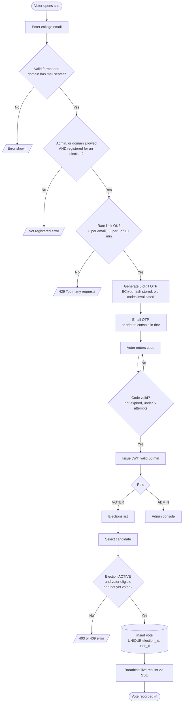
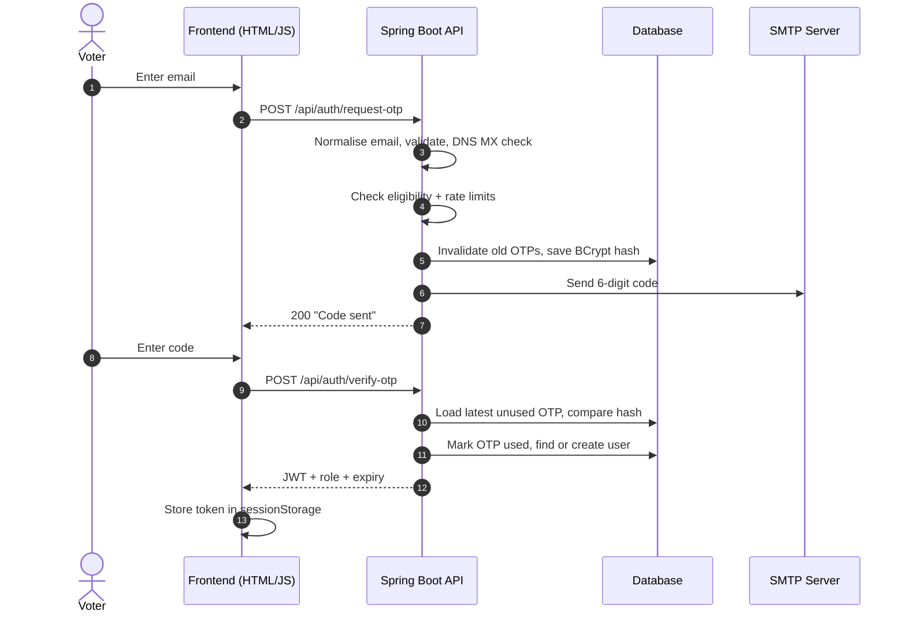
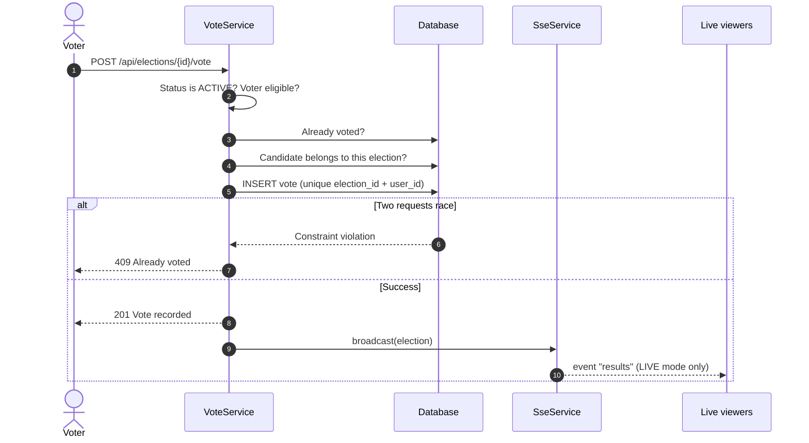
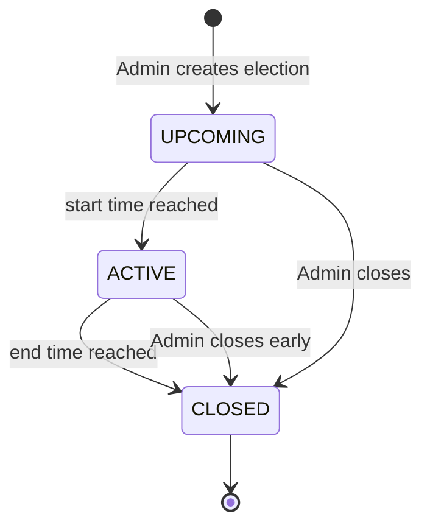
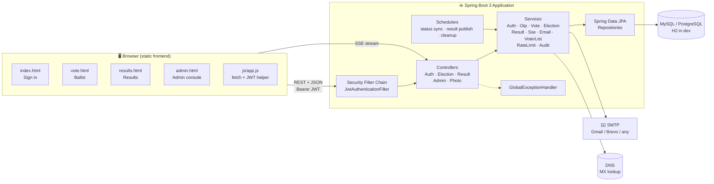
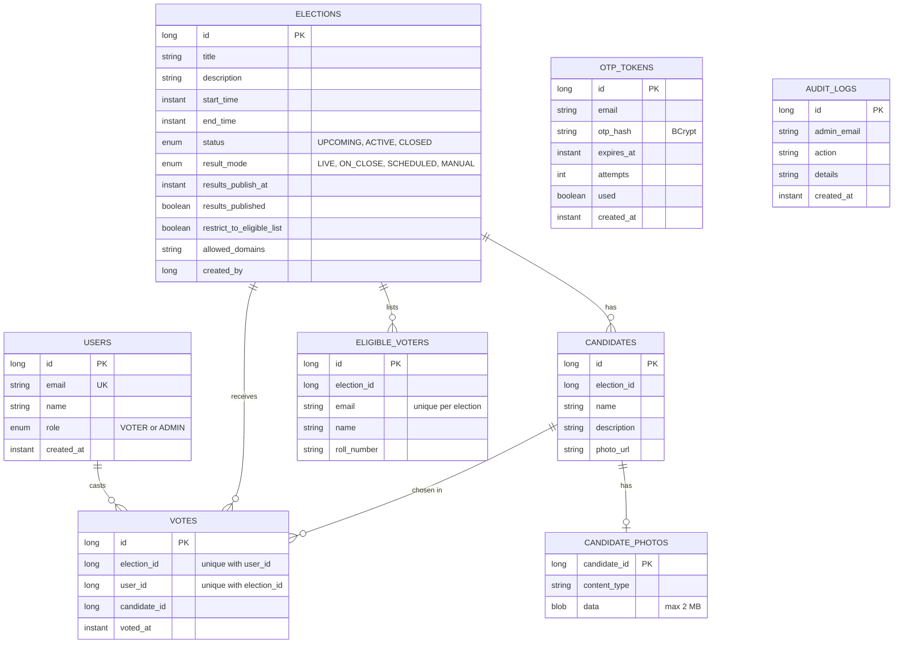

<div align="center">

# 🗳️ Online Voting System

### Secure, passwordless, one-person-one-vote elections for colleges

_Sign in with an email code. Vote once. Watch results on your terms._


[Features](#-features) · [How it works](#-how-it-works) · [Architecture](#-architecture) · [Tech stack](#-tech-stack) · [Quick start](#-quick-start) · [Configuration](#-configuration) · [API](#-api-reference) · [Deployment](#-deployment) · [Security](#-security-design)

</div>

---

## 📖 Overview

**Online Voting System** is a full-stack web application for running verifiable, college-scale elections. A **Spring Boot 3** backend exposes a REST API and serves a lightweight **HTML/CSS/JavaScript** frontend from the same process, so the whole system ships as a single deployable unit.

Voters never create or remember a password. They enter their college email, receive a 6-digit one-time code, and are signed in with a short-lived **JWT**. Admins create elections, manage candidates and voter lists, monitor turnout, and decide exactly **when and how results become visible**.

> **Design goals:** simple to deploy, hard to cheat, easy to audit.

---

## ✨ Features

### 👩‍🎓 For voters

- 🔐 **Passwordless sign-in** with an emailed one-time code (OTP)
- 🗂️ See only the elections you are eligible for
- 🧑‍💼 Browse candidates with photos and descriptions
- ✅ Cast **one vote per election**, guaranteed by a database constraint
- 🔎 Check whether you have voted (and when), never _who_ you voted for
- 📊 View results according to the election's visibility rule, including **live streaming** results

### 🛠️ For administrators

- 🆕 Create, edit, close and delete elections with a voting window
- 👥 Manage candidates, including **photo upload** (JPG, PNG, WebP, GIF, max 2 MB)
- 📥 Bulk-import the voter list from **CSV** (auto-normalised, de-duplicated, domain-validated)
- 🌐 Choose eligibility: **voter list only** or **open to a college email domain**
- 🏷️ Set **per-election allowed email domains** (multiple domains supported)
- 📈 Live **turnout dashboard**: eligible, voted, pending, percentage
- 📤 Export **voted / not-voted lists** and **results** as CSV
- 👁️ Control result visibility: `LIVE`, `ON_CLOSE`, `SCHEDULED`, `MANUAL`
- 🧾 Full **audit log** of every admin action

### 🛡️ Built-in protections

- BCrypt-hashed OTPs with expiry and attempt limits
- Sliding-window **rate limiting** per email and per IP
- Stateless JWT authentication with role-based access (`VOTER`, `ADMIN`)
- DNS **MX/A record check** to reject fake email domains
- Ballot locks after the first vote
- Non-root Docker container and graceful shutdown

---

## 🔄 How it works



### 🔑 Sign-in sequence



### 🗳️ Vote sequence (race-safe)



### 👁️ Election lifecycle and result visibility



| Mode        | Voters see results when…                               |
| ----------- | ------------------------------------------------------ |
| `LIVE`      | Always, with real-time updates over Server-Sent Events |
| `ON_CLOSE`  | The election has closed (default)                      |
| `SCHEDULED` | A fixed date and time arrives                          |
| `MANUAL`    | The admin presses **Publish**                          |

> Admins always see live counts, regardless of mode. Status is **derived from the clock**, so it is correct even if the background scheduler has not run yet.

---

## 🏗️ Architecture



### Layered design

| Layer                | Package                          | Responsibility                                                   |
| -------------------- | -------------------------------- | ---------------------------------------------------------------- |
| **Presentation**     | `controller`                     | HTTP routes, request validation, status codes                    |
| **Business logic**   | `service`                        | Eligibility, OTP, voting rules, results, SSE, email, rate limits |
| **Persistence**      | `repository`, `entity`           | JPA entities and Spring Data repositories                        |
| **Security**         | `security`, `config`             | JWT filter, token utility, CORS, route authorization             |
| **Cross-cutting**    | `exception`, `util`, `scheduler` | Error mapping, CSV/email helpers, background jobs                |
| **Transfer objects** | `dto`                            | Request and response records                                     |

---

## 🧰 Tech stack

| Area                | Technology                                                      |
| ------------------- | --------------------------------------------------------------- |
| **Language**        | Java 17                                                         |
| **Framework**       | Spring Boot 3.3.5 (Web, Data JPA, Security, Validation, Mail)   |
| **Authentication**  | JWT via JJWT 0.12.6, stateless sessions, BCrypt for OTP hashing |
| **Database**        | MySQL 8.4 · PostgreSQL · H2 (development)                       |
| **ORM**             | Hibernate / Spring Data JPA (`ddl-auto=update`)                 |
| **Real-time**       | Server-Sent Events (`SseEmitter`) with 25 s heartbeat           |
| **Email**           | Spring Mail over SMTP (Gmail, Brevo, or any provider)           |
| **API docs**        | springdoc-openapi 2.6.0 (Swagger UI)                            |
| **Frontend**        | Vanilla HTML5, CSS3, JavaScript (no build step)                 |
| **Build**           | Maven                                                           |
| **Boilerplate**     | Lombok 1.18.42                                                  |
| **Testing**         | JUnit 5, Spring Boot Test, Spring Security Test                 |
| **Containers**      | Docker multi-stage build, Docker Compose (app + MySQL)          |
| **Hosting options** | Render, Google Cloud Run, any VPS                               |

---

## 🗄️ Data model

Tables are created automatically by Hibernate. Relationships are held as ID columns.



---

## 🚀 Quick start

### Prerequisites

- **Java 17+**
- **Maven 3.9+** (or use Docker)

### 1. Run locally (about 2 minutes)

```bash
git clone https://github.com/itz-Arun-001/online_voting_system
cd online-voting-system
mvn spring-boot:run
```

Open **http://localhost:8080**

- The default `dev` profile uses a file-based **H2** database stored in `./data/`.
- With no SMTP configured, the **sign-in code is printed in the console**, so you can test without email.
- Sign in as the default admin `admin@yourcollege.edu` to reach the admin console.

### 2. Send real OTP emails

1. Copy `.env.example` to `.env` in the project folder (where you run `mvn`).
2. Fill in `SMTP_HOST`, `SMTP_USER`, `SMTP_PASSWORD`.
   _Gmail:_ enable 2-Step Verification, then create an App Password at <https://myaccount.google.com/apppasswords>.
3. Set `COLLEGE_DOMAIN` and `ADMIN_EMAILS`. Codes are only sent to addresses on the allowed domain that are an admin or on a voter list. To test with Gmail, use `COLLEGE_DOMAIN=gmail.com`.
4. Start the app. The console should print `Email is configured: ...`. If it says `NOT configured`, the `.env` file was not found.

### 3. Run with Docker Compose (app + MySQL)

```bash
cp .env.example .env      # then edit the values
docker compose up --build -d
```

Serves on **http://localhost:8080** with a persistent MySQL volume. Put it behind HTTPS before sharing the link.

### 4. Run the tests

```bash
mvn test
```

---

## ⚙️ Configuration

All settings are environment variables (or entries in `.env`).

| Variable                                               | Purpose                                                                            | Default                 |
| ------------------------------------------------------ | ---------------------------------------------------------------------------------- | ----------------------- |
| `SPRING_PROFILES_ACTIVE`                               | `dev` (H2) or `prod` (real database)                                               | `dev`                   |
| `COLLEGE_DOMAIN`                                       | Comma-separated domains allowed to sign in                                         | `yourcollege.edu`       |
| `ADMIN_EMAILS`                                         | Comma-separated admin emails (seeded at startup, no admin signup)                  | `admin@yourcollege.edu` |
| `JWT_SECRET`                                           | 32+ random characters. **Required in production**; app refuses to start without it | dev only                |
| `JWT_EXPIRY_MINUTES`                                   | Token lifetime                                                                     | `60`                    |
| `DB_URL`, `DB_USERNAME`, `DB_PASSWORD`                 | `jdbc:mysql://…` or `jdbc:postgresql://…`                                          | none                    |
| `DB_POOL_SIZE`                                         | Hikari pool size                                                                   | `5`                     |
| `DDL_AUTO`                                             | Hibernate schema mode                                                              | `update`                |
| `SMTP_HOST`, `SMTP_PORT`, `SMTP_USER`, `SMTP_PASSWORD` | Mail server for OTPs                                                               | none / `587`            |
| `MAIL_FROM`                                            | From address (Gmail needs it equal to `SMTP_USER`)                                 | `SMTP_USER`             |
| `DISPLAY_ZONE`                                         | Time zone for server-written messages                                              | `Asia/Kolkata`          |
| `CORS_ORIGINS`                                         | Only needed if the frontend is hosted elsewhere                                    | empty                   |
| `PORT`                                                 | HTTP port                                                                          | `8080`                  |
| `DB_ROOT_PASSWORD`                                     | MySQL root password (Docker Compose)                                               | `change-me-too`         |

**Built-in tuning (in `application.properties`):**

| Setting                              | Value                    |
| ------------------------------------ | ------------------------ |
| OTP length / validity / max attempts | 6 digits / 5 minutes / 5 |
| OTP requests per email               | 3 per 10 minutes         |
| OTP requests per IP                  | 60 per 10 minutes        |
| Verify attempts per IP               | 120 per 10 minutes       |
| Max upload size                      | 2 MB                     |

---

## 🧑‍⚖️ Running an election

1. **Sign in as admin** and create an election: title, voting window, result mode, and whether it is restricted to a voter list or open to a domain.
2. **Add candidates** (optionally with photos).
3. **Upload the voter list** as CSV. Emails must be on an allowed domain.
4. **Share the site link.** Voters sign in and vote.
5. **Monitor turnout**, download the voted / not-voted lists, and publish results as configured.
6. **Export results** and the audit log for your records.

**Voter CSV format** (`voters.csv`):

```csv
email,name,roll_number
aarav.kumar@yourcollege.edu,Aarav Kumar,CS001
meera.iyer@yourcollege.edu,Meera Iyer,CS002
Rohan.Das@YourCollege.edu,Rohan Das,CS003
```

The header row is optional. Emails are trimmed and lowercased, so `Rohan.Das@YourCollege.edu` and `rohan.das@yourcollege.edu` are the same person. Duplicates and invalid rows are reported in the upload summary.

**Rules to know:**

- The candidate list and photos lock after the first vote.
- An election with votes cannot be deleted.
- Closing an election early moves its end time to now.
- Every admin action is written to the audit log.

---

## 📡 API reference

Interactive docs: **`/swagger-ui.html`** · OpenAPI JSON: **`/v3/api-docs`**

### Public

| Method | Endpoint                            | Description                        |
| ------ | ----------------------------------- | ---------------------------------- |
| `POST` | `/api/auth/request-otp`             | Email a one-time code              |
| `POST` | `/api/auth/verify-otp`              | Verify code, receive JWT           |
| `GET`  | `/api/public/config`                | Allowed domains, OTP length, hints |
| `GET`  | `/api/public/candidates/{id}/photo` | Candidate photo                    |

### Voter (requires `Authorization: Bearer <token>`)

| Method | Endpoint                             | Description                              |
| ------ | ------------------------------------ | ---------------------------------------- |
| `GET`  | `/api/elections`                     | Elections you are eligible for           |
| `GET`  | `/api/elections/{id}`                | Election details                         |
| `GET`  | `/api/elections/{id}/candidates`     | Candidates                               |
| `POST` | `/api/elections/{id}/vote`           | Cast your vote                           |
| `GET`  | `/api/elections/{id}/my-status`      | Have I voted, and when                   |
| `GET`  | `/api/elections/{id}/results`        | Results (if visible)                     |
| `GET`  | `/api/elections/{id}/results/stream` | Live results over SSE (`LIVE` mode only) |

### Admin (requires `ADMIN` role)

| Area           | Endpoints                                                                                                                                                         |
| -------------- | ----------------------------------------------------------------------------------------------------------------------------------------------------------------- |
| **Elections**  | `GET/POST /api/admin/elections` · `PUT/DELETE /api/admin/elections/{id}` · `PUT …/{id}/close`                                                                     |
| **Candidates** | `GET/POST /api/admin/elections/{id}/candidates` · `PUT/DELETE /api/admin/candidates/{id}` · `POST/DELETE /api/admin/candidates/{id}/photo`                        |
| **Voters**     | `POST …/{id}/voters/upload` · `GET …/voters/eligible` · `GET …/voters/voted` · `GET …/voters/not-voted` · `DELETE …/voters/{email}` · `GET …/voters/export?type=` |
| **Turnout**    | `GET …/{id}/turnout`                                                                                                                                              |
| **Results**    | `PUT …/{id}/result-settings` · `POST …/{id}/publish-results` · `GET …/{id}/results` · `GET …/{id}/results/export`                                                 |
| **Audit**      | `GET /api/admin/audit-logs`                                                                                                                                       |

### Try it with curl

```bash
# 1. Request a code (printed in the console in dev)
curl -X POST localhost:8080/api/auth/request-otp \
  -H 'Content-Type: application/json' \
  -d '{"email":"admin@yourcollege.edu"}'

# 2. Exchange the code for a JWT
curl -X POST localhost:8080/api/auth/verify-otp \
  -H 'Content-Type: application/json' \
  -d '{"email":"admin@yourcollege.edu","otp":"123456"}'

# 3. Call a protected route
curl localhost:8080/api/elections -H "Authorization: Bearer <token>"
```

### Error format

Errors return JSON: `{"status": 409, "message": "You have already voted in this election."}`

| Code  | Meaning                                       |
| ----- | --------------------------------------------- |
| `400` | Bad input, voting not open, invalid candidate |
| `401` | Missing/expired token or wrong OTP            |
| `403` | Not eligible, not admin, or results hidden    |
| `404` | Election or candidate not found               |
| `409` | Already voted, already closed                 |
| `429` | Rate limit exceeded                           |

---

## 🔒 Security design

| Concern                     | How it is handled                                                                                                                    |
| --------------------------- | ------------------------------------------------------------------------------------------------------------------------------------ |
| **No passwords**            | Email OTP only; codes are BCrypt-hashed, never stored in plain text                                                                  |
| **OTP brute force**         | 5 attempts per code, 5-minute expiry, single use, new code invalidates the old one                                                   |
| **Request abuse**           | Sliding-window rate limits per email and per IP                                                                                      |
| **Double voting**           | Database `UNIQUE (election_id, user_id)` plus an application check, safe under concurrent requests (covered by a parallel-vote test) |
| **Authorization**           | Stateless JWT, `/api/admin/**` restricted to `ADMIN`; voters can only open elections they are eligible for                           |
| **Ballot integrity**        | Candidates and photos lock after the first vote; candidate must belong to the election                                               |
| **Admin accounts**          | Seeded only from `ADMIN_EMAILS`; there is no admin signup                                                                            |
| **Voter privacy in the UI** | Admin voter lists and `my-status` expose who voted and when, never the choice                                                        |
| **Fake domains**            | DNS MX/A lookup (cached) before any code is sent                                                                                     |
| **Email consistency**       | All emails trimmed and lowercased everywhere                                                                                         |
| **Accountability**          | Every admin action recorded in `audit_logs`                                                                                          |
| **Secrets**                 | `JWT_SECRET` must be 32+ chars or the app will not start; `.env` is git-ignored                                                      |
| **Container**               | Runs as a non-root user with graceful shutdown                                                                                       |

---

## 🧪 Testing

`mvn test` runs **18 tests** against an isolated test profile (scheduling disabled):

- **Authentication:** non-college email rejected · wrong OTP and lockout after max attempts · expired OTP · OTP works only once · new OTP invalidates the old one · per-email rate limiting
- **Voting:** double vote returns conflict · voting before start / after close fails · voter outside the list rejected · candidate from another election rejected · **parallel votes from one user save exactly one vote**
- **Results:** `ON_CLOSE` hidden until close · `SCHEDULED` hidden until publish time · `MANUAL` needs publish, `LIVE` always visible · admin counts available while hidden from voters
- **Utilities:** email normalisation, case-insensitive domain check, bad-format rejection

---

## ☁️ Deployment

Full instructions, including an election-day checklist and troubleshooting, are in **[DEPLOY.md](DEPLOY.md)**.

| Option                      | Best for               | Notes                                                                 |
| --------------------------- | ---------------------- | --------------------------------------------------------------------- |
| **Render + Neon Postgres**  | Free, no billing setup | Free instances sleep when idle; open the site before voting starts    |
| **Google Cloud Run**        | Always-on, scalable    | `--min-instances 1` is billed; use external Postgres to keep cost low |
| **Docker Compose on a VPS** | Full control           | Bundled MySQL; add HTTPS with Caddy or a Cloudflare Tunnel            |

Minimum production variables:

```bash
SPRING_PROFILES_ACTIVE=prod
DB_URL=jdbc:postgresql://HOST/DBNAME?sslmode=require
DB_USERNAME=...
DB_PASSWORD=...
JWT_SECRET=$(openssl rand -base64 48)
COLLEGE_DOMAIN=yourcollege.edu
ADMIN_EMAILS=you@yourcollege.edu
SMTP_HOST=smtp.gmail.com
SMTP_PORT=587
SMTP_USER=...
SMTP_PASSWORD=...
```

---

## 📁 Project structure

```
online-voting-system/
├── pom.xml                       # Maven build and dependencies
├── Dockerfile                    # Multi-stage build (Maven → JRE 17)
├── docker-compose.yml            # App + MySQL 8.4
├── .env.example                  # Template for secrets and SMTP
├── voters.csv                    # Sample voter list
├── DEPLOY.md                     # Deployment guide
└── src/
    ├── main/
    │   ├── java/com/example/voting/
    │   │   ├── VotingApplication.java
    │   │   ├── config/           # AppProperties, SecurityConfig, DataInitializer, OpenApiConfig
    │   │   ├── controller/       # Auth, Election, Result, Admin, Photo
    │   │   ├── dto/              # Request/response records
    │   │   ├── entity/           # User, Election, Candidate, CandidatePhoto,
    │   │   │                     # EligibleVoter, Vote, OtpToken, AuditLog
    │   │   ├── enums/            # Role, ElectionStatus, ResultMode
    │   │   ├── exception/        # ApiException, GlobalExceptionHandler
    │   │   ├── repository/       # Spring Data JPA repositories
    │   │   ├── scheduler/        # Status sync, result publishing, cleanup
    │   │   ├── security/         # JwtUtil, JwtAuthenticationFilter, AuthUser
    │   │   ├── service/          # Auth, Otp, Vote, Election, Result, Sse,
    │   │   │                     # Email, VoterList, RateLimit, Audit
    │   │   └── util/             # CsvUtil, EmailUtil
    │   └── resources/
    │       ├── application.properties
    │       ├── application-dev.properties    # H2 database
    │       ├── application-prod.properties   # MySQL / PostgreSQL
    │       └── static/
    │           ├── index.html    # Sign in
    │           ├── vote.html     # Voter dashboard and ballot
    │           ├── results.html  # Results view
    │           ├── admin.html    # Admin console
    │           ├── css/style.css
    │           └── js/app.js     # Shared fetch/JWT helpers
    └── test/
        ├── java/com/example/voting/   # VotingFlowTest, EmailUtilTest
        └── resources/application-test.properties
```

### Frontend pages

| Page           | Audience | Purpose                                                              |
| -------------- | -------- | -------------------------------------------------------------------- |
| `index.html`   | Everyone | Email → OTP sign-in                                                  |
| `vote.html`    | Voters   | Elections list, candidates, cast vote                                |
| `results.html` | Voters   | Results, live-updating in `LIVE` mode                                |
| `admin.html`   | Admins   | Elections, candidates, voters, turnout, results, settings, audit log |

---

## ⏱️ Background jobs

| Job              | Schedule     | What it does                                         |
| ---------------- | ------------ | ---------------------------------------------------- |
| Status sync      | Every minute | Moves elections `UPCOMING → ACTIVE → CLOSED`         |
| Result publisher | Every minute | Marks `SCHEDULED` / `ON_CLOSE` results as published  |
| Cleanup          | Hourly       | Deletes stale OTPs and purges old rate-limit entries |
| SSE heartbeat    | Every 25 s   | Keeps live-result connections alive through proxies  |

---

## ⚠️ Known limitations

- **Rate limiting is in memory.** It resets on restart and is per server instance.
- **Votes are linked to users** (simple and auditable). For fully anonymous ballots, split `votes` into a "has voted" table and a separate ballot table.
- **SSE subscribers are per instance.** With several instances, live updates reach only viewers connected to the instance that handled the vote.
- **Client IP comes from `X-Forwarded-For`.** Run behind a trusted proxy that sets this header.
- **Free hosts may sleep** when idle. Open the site a few minutes before voting starts.
- **Never run a real election over plain HTTP.** Render and Cloud Run provide HTTPS automatically.

---

## 🗺️ Roadmap ideas

- Anonymous ballot separation (voter-receipt table + ballot table)
- Distributed rate limiting (Redis)
- Multi-position ballots and ranked-choice voting
- Result charts and PDF export
- Database migrations with Flyway or Liquibase

---

## 🤝 Contributing

1. Fork the repository
2. Create a branch: `git checkout -b feature/my-feature`
3. Make your changes and run `mvn test`
4. Commit and push, then open a Pull Request

---

## 📄 License

No license file is included yet. Add one (for example MIT) before publishing publicly.

---

<div align="center">

**Built with ☕ Java and Spring Boot**

If this project helped you, consider giving it a ⭐

</div>
